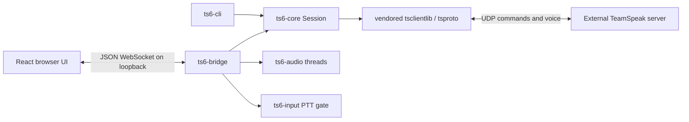

# Architecture

This describes the current source tree, not a complete TeamSpeak 6 implementation. Read the [README](../README.md) for status and [historical measurements](verification.md) for earlier observations. English is required for first-party project content.

## Component boundaries

| Module | Main interfaces and responsibility |
| --- | --- |
| `ts6-core/src/config.rs` | `ClientConfig`, identity location, optional passwords/channel/bind IP, diagnostic logging |
| `ts6-core/src/identity.rs` | Load/create JSON P-256 identity and security counter; the file is an account credential |
| `ts6-core/src/session.rs` | `Session`, connection/sync, pending item queue, correlated commands, deadlines, duplex polling |
| `ts6-core/src/state.rs` | Serializable server/channel/client snapshots and channel lookup |
| `ts6-audio/src/codec.rs` | Opus frames at mono 48 kHz, 20 ms per frame |
| `ts6-audio/src/capture.rs`, `playback.rs` | Device streams on dedicated threads with bounded frame/packet channels |
| `ts6-audio/src/mixer.rs`, `resample.rs` | Per-peer decoding/jitter handling and linear sample-rate conversion |
| `ts6-input` | Binding parser, Windows `GetAsyncKeyState` polling, transmit gate |
| `ts6-bridge/src/main.rs` | Axum loopback HTTP/static assets/WebSocket, shared command channel, broadcast events, one session owner |
| `ts6-bridge/src/audio.rs` | Bridge audio configuration, counters, optional synthetic tone, PTT orchestration |
| `ts6-bridge/src/protocol.rs` | Serde command/event wire schema; mirrored by UI `src/types.ts` |
| `apps/ui/src/useBridge.ts` | WebSocket lifecycle/reconnect and latest state; React components render it |

The Cargo workspace contains five first-party crates. The vendored protocol tree is a separate workspace, excluded from the main workspace membership. The standalone `recon/probe-ts6` is outside both and uses the tracked protocol copy.

## Session and threading constraints

The protocol connection is `!Send`. Its event stream drives socket I/O and must be continuously polled by one owner. The bridge uses a multi-thread Tokio runtime while keeping the session future on the `block_on` thread. The HTTP server is a separate task. Do not move the session into an ordinary spawned `Send` task or introduce competing receive futures.

The custom `Session::poll_with` multiplexes pending items, network events, microphone frames, and UI commands. Keep bounded microphone work and wake registration so one input cannot monopolize the loop. Avoid repeatedly cancelling receives with short timeouts; previous experiments reported delayed audio. Handshake/sync and disconnect drains have hard deadlines, and the pending item queue is capped at 4096.

Capture, playback, and key polling run separately. The PTT gate must shut down with an idle sender still open. Invalid bindings disable transmission. Hardware callbacks should avoid unbounded work or queues. A linear resampler and the upstream jitter handler are present; adaptive jitter control, echo cancellation, and noise suppression are not.

## Protocol boundaries

The implemented session uses the vendored TS3-compatible UDP handshake, command escaping, correlated replies, identity, bookkeeping, and voice transport. Unknown TS6 commands are surfaced through `StreamItem::UnknownCommand`. `Session::send_command` uses `OutCommand` and `write_arg`; do not concatenate unescaped user parameters.

Earlier tests accepted `setupstream` and returned stream notifications. This does not implement WebRTC video. Earlier research found Matrix-related group-chat components and S3/services integration for files, but neither is integrated here. Voice-channel chat and persistent group chat require separate verification; do not assume all text workflows use Matrix. A successful `sendtextmessage` response did not establish message delivery in the historical server test.

Read [ts3j protocol research](protocol-ts3j.md), [Astrum research](protocol-ts6-astrum.md), and [WebSpeak research](webspeak.md) as historical reference, not as installed dependencies or a maintained external specification. Their line references refer to ignored research clones. Do not copy incompatible third-party code; see [notices](../client/THIRD_PARTY.md).

## Security boundaries

The bridge binds only `127.0.0.1`, checks exact local Host/Origin values, and limits WebSocket frames/messages to 16 KiB. Local native clients without Origin remain allowed. This service is not authenticated or suitable for exposing through a proxy to other machines. Multiple local clients share one session and broadcast stream; there is no per-user isolation.

Private destination blocking is supplied by the vendored resolver and can be explicitly disabled with `ALLOW_PRIVATE_TARGETS=1`. Credentials belong in process/user configuration, never tracked files or Debug output. Verbose protocol logging is still sensitive. Identity creation uses exclusive file creation, rejects symbolic links, and applies POSIX 0600; Windows relies on the enclosing user's ACL. Interrupted creation can leave a malformed file: fail visibly and recover from a protected backup, never silently generate a replacement account.

## Deliberate decisions and remaining risks

Keep Rust/React and the existing protocol fork; avoid a transport rewrite during maintenance hardening. Keep the existing MIT license and all upstream notices. Record vendored patches in [UPSTREAM.md](../client/UPSTREAM.md).

Tauri packaging, Matrix, WebRTC, S3, multi-user bridge authorization, non-Windows global key support, and comprehensive automated server integration tests remain future work. The Rust cryptography advisory, unmaintained native codec dependency, tone-rate anomaly, and late-join measurements require follow-up; see [AUDIT.md](AUDIT.md). Historical explanations of server/runtime causes are hypotheses or observations until reproduced with packet-level evidence.
